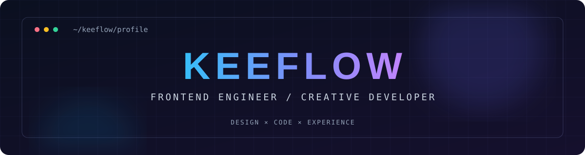

<div align="center">



<br />

<a href="https://github.com/keeflow?tab=followers"></a>


### `> building thoughtful digital experiences_`


</div>

## `01 / ABOUT`

```ts
const keeflow = {
  role: 'Frontend Engineer',
  focus: ['Web Apps', 'Mobile H5', 'Mini Programs', 'UI Engineering'],
  stack: ['Vue 3', 'TypeScript', 'Vite', 'Tailwind CSS', 'Uni-app'],
  philosophy: 'Build clean, useful and delightful experiences.',
}
```

## `02 / TOOLBOX`

<div align="center">
  
</div>

## `03 / GITHUB SIGNAL`

<div align="center">
  
  
</div>

> Stats are generated by a third-party service and may be temporarily unavailable or incomplete.

## `04 / CONTRIBUTION FLOW`

<div align="center">
  <picture>
    <source media="(prefers-color-scheme: dark)" srcset="https://raw.githubusercontent.com/keeflow/keeflow/output/github-contribution-grid-snake-dark.svg" />
    <source media="(prefers-color-scheme: light)" srcset="https://raw.githubusercontent.com/keeflow/keeflow/output/github-contribution-grid-snake.svg" />
    
  </picture>
</div>

## `05 / SELECTED WORK`

<!-- Replace these placeholders with real repositories when ready. -->
<div align="center">
  <a href="https://github.com/keeflow?tab=repositories"></a>
</div>

---

<div align="center">
  <sub>Designed with intention · Built with curiosity · <a href="https://github.com/keeflow">@keeflow</a></sub>
</div>
